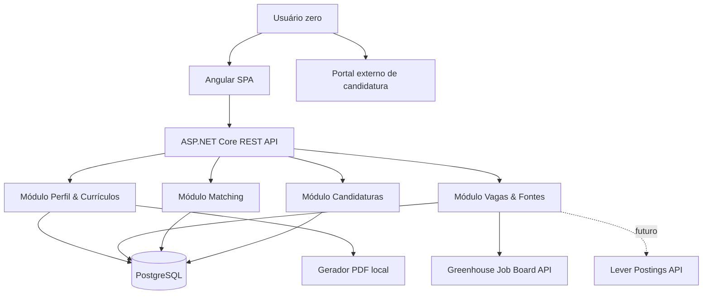
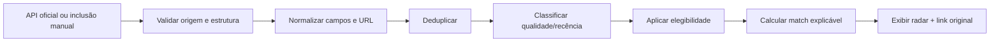

# VagaFlow — Arquitetura Técnica e ADRs

**Versão-alvo:** MVP 0.1, execução local  
**Critério de escolha:** mínimo custo operacional, testabilidade e velocidade para entregar a jornada completa.

## 1. Decisões de arquitetura (ADRs iniciais)

| ADR | Decisão | Justificativa | Consequência |
|---|---|---|---|
| ADR-001 | Monólito modular em **ASP.NET Core/.NET 10** | Evitar microserviços prematuros | Módulos de domínio isolados no mesmo backend |
| ADR-002 | SPA **Angular/TypeScript** | Aproveita domínio técnico existente | API REST explícita |
| ADR-003 | **PostgreSQL** com EF Core | Persistência relacional robusta, migrações | Banco local via Compose |
| ADR-004 | **Sem IA obrigatória no 0.1** | Custo R$ 0 de inferência e maior explicabilidade | Matching determinístico versionado |
| ADR-005 | **API oficiais + importação manual** | Evita depender de scraping indiscriminado | Cobertura por empresa, não global |
| ADR-006 | **Local-first single-user** | Usuário zero começa imediatamente | Não publicar na Internet sem autenticação e revisão de segurança |
| ADR-007 | PDF via template HTML/CSS renderizado por Chromium | Texto ATS selecionável e links clicáveis | Dependência de navegador headless no processo de geração |

## 2. Visão C4 simplificada



- O servidor de desenvolvimento escuta somente `127.0.0.1`; CORS limitado ao origin local.
- HTTPS/TLS e autenticação tornam-se obrigatórios antes de exposição pública.
- Nenhum dado pessoal do candidato é enviado a fontes de vagas: consultas usam identificadores públicos de empresa/board.

## 3. Módulos e responsabilidades

**Profiles:** dados verificados, interesses, formação, experiências, skills e preferências; regras de confirmação.

**Resumes:** versões de currículo, associação com perfil, renderização HTML→PDF, anexos PDF originais e histórico de exportações. Variantes Geral/PcD são selecionadas por política explícita.

**Sources & Jobs:** cadastro de fontes e empresas, adaptadores, ingestão, normalização, deduplicação, recência e verificação.

**Matching:** regras determinísticas, filtros de elegibilidade, pesos, razões e indicações de currículo.

**Applications:** registro de aplicação pelo usuário, estado, datas, anotações e checagem de duplicação.

## 4. Entidades e campos essenciais

```text
ProfessionalProfile(id, name, city, state, country, summary, salary_reference,
                    preferred_areas[], preferred_work_modes[], updated_at)
Experience(id, profile_id, company, role, started_on, ended_on, description, confirmed)
Education(id, profile_id, institution, program, started_on, ended_on, confirmed)
Skill(id, normalized_name, aliases[])
ProfileSkill(profile_id, skill_id, evidence_type)
ResumeVersion(id, profile_id, area, audience, title, template_version,
              source_pdf_path?, generated_pdf_path?, confirmed_at?)
JobSource(id, provider, company_name, provider_board_id, usage_policy, active)
Job(id, source_id, external_id?, canonical_url, company_name, title,
    description, area?, city?, state?, country?, work_mode?, remote_scope?,
    salary_min?, salary_max?, pcd_policy?, published_at?, published_provenance?,
    source_updated_at?, first_seen_at, last_checked_at?, verification_status)
MatchResult(id, profile_id, job_id, scorer_version, eligible_state,
            score?, criteria_json, reasons_json, resume_version_id?, assessed_at)
Application(id, profile_id, job_id, resume_version_id?, status,
            submitted_at?, notes?, updated_at)
```

**Índices/restrições:** `unique(source_id, external_id)` quando disponível; chave única para URL canônica normalizada; índice em `published_at`, `city`, `work_mode`; trava de duplicidade da aplicação `(profile_id, job_id)` (permitir reaplicação apenas com fluxo explícito posterior).

**Campos não armazenados por padrão:** laudo, CID, diagnóstico, dados biométricos. Preferência de busca por vagas afirmativas PcD não implica salvar informação médica ou exportá-la.

## 5. Contrato de normalização de vagas

Toda integração retorna um DTO interno uniforme:

```json
{
  "source": "greenhouse",
  "sourceCompany": "Empresa Exemplo",
  "externalId": "12345",
  "title": "Desenvolvedor Júnior",
  "applicationUrl": "https://exemplo.com/carreiras/12345",
  "locationText": "Brazil - Remote",
  "workMode": "remote",
  "remoteScope": "BR",
  "publishedAt": null,
  "publishedProvenance": "unknown",
  "firstSeenAt": "2026-11-12T18:00:00Z",
  "verificationStatus": "requires_review"
}
```

Os valores do JSON acima são **fictícios e ilustrativos**. Jamais inferir `publishedAt` de `firstSeenAt`, `updated_at` ou do horário da sincronização.

### Política de fontes

- **Greenhouse GET:** job boards públicos sem autenticação para leitura; requer conhecer o `board_token` da empresa e não permite interpretar uma única lista de empresas como busca global.
- **Lever Postings API:** leitura de anúncios de empresas específicas; avaliação posterior de regras de uso e cobertura.
- **Adzuna:** não assumir uso comercial gratuito; API de avaliação gratuita possui condições e licenciamento para uso continuado comercial.
- **Portais sem integração:** formulário de inclusão manual com link e campos confirmados; nenhum fetch arbitrário do lado do servidor nesta versão.
- Em qualquer integração: respeitar termos, limites, respostas 429, timeout, `Retry-After`, backoff, User-Agent identificável e atribuição quando exigida.

## 6. Pipeline de busca



**Três estados de dados:** `verified` (fonte confiável, empresa + link + requisitos conhecidos), `requires_review` (data/localidade ambígua, empresa ou link sem confirmação), `stale_or_closed` (indício de expiração/erro). Um HTTP 200 isolado **não** comprova vaga aberta.

## 7. Algoritmo de elegibilidade e pontuação (MVP)

1. **Pré-filtros:** empresa identificada e link; modalidade/localidade compatível; data de publicação comprovada se o filtro de recência estiver ativo; vaga ainda não marcada como encerrada.
2. **Estados:** `eligible`, `ineligible`, `needs_review`; dado desconhecido provoca revisão, não inventa compatibilidade.
3. **Score heurístico 0–100, apenas para elegíveis:** habilidades 35, experiências relevantes e transferíveis 25, senioridade 15, modalidade/localidade 15, remuneração/condições 10. Pesos serão calibrados com feedback real; não constituem probabilidade de contratação.
4. **Informação desconhecida:** registrar como `unknown`; componente desconhecido não recebe 0 arbitrário. Mostrar cobertura de evidências e calcular score apenas dos pesos avaliáveis, com transparência da cobertura.
5. **Fatores explicáveis:** `met`, `gap`, `unknown` com pequenas mensagens, por exemplo `Atende: Python`, `Não informado: escala`, `Incompatível: presencial em outra cidade`.
6. **Sugestão de CV:** área da vaga escolhe TI ou Logística; exclusivamente afirmativa PcD sugere variante PcD; nos outros casos, Geral. Escolha final permanece com o candidato. Não incluir dados clínicos automaticamente.

### Pseudocódigo

```text
if not identified_company or not trusted_application_url: requires_review
if confirmed_location_conflict: ineligible
if strict_recent_filter and published_at is unknown: requires_review
if strict_recent_filter and published_at < selected_date: ineligible
assess known weighted criteria; compute score over assessed weights
return {eligibility, score, coverage, reasons, suggested_resume}
```

## 8. Endpoints REST sugeridos

| Verbo | Rota | Função |
|---|---|---|
| GET/PUT | `/api/v1/profile` | Consultar/editar perfil |
| GET/POST | `/api/v1/resumes` | Listar/cadastrar versões |
| POST | `/api/v1/resumes/{id}/generate` | Gerar PDF com revisão |
| GET | `/api/v1/resumes/{id}/download` | Baixar PDF |
| GET | `/api/v1/jobs` | Listar/filtrar vagas |
| POST | `/api/v1/jobs/manual` | Importação manual validada |
| GET | `/api/v1/jobs/{id}` | Detalhar vaga |
| GET | `/api/v1/jobs/{id}/match` | Justificativa de compatibilidade |
| GET/POST | `/api/v1/sources` | Configurar fontes locais |
| POST | `/api/v1/sources/{id}/sync` | Iniciar sincronização local |
| GET/POST | `/api/v1/applications` | Consultar/criar candidaturas |
| PATCH | `/api/v1/applications/{id}` | Alterar status manualmente |
| GET | `/health` | Health check |

POST/PATCH exigem validação de DTO e nunca enviam dados a portais de terceiros. Antes de exposição pública, inserir camada de identidade, autorização, CSRF/CORS revisados, limites de taxa, auditoria e TLS.

## 9. Organização inicial do repositório

```text
vagaflow/
├── README.md
├── docs/
│   ├── 01-VISAO-DO-PRODUTO.md
│   ├── 02-ESCOPO-MVP-0.1.md
│   ├── 03-ARQUITETURA.md
│   └── 04-BACKLOG-INICIAL.md
├── planning/
│   └── backlog.csv
├── backend/
│   ├── src/VagaFlow.Api/
│   ├── src/VagaFlow.Domain/
│   ├── src/VagaFlow.Application/
│   ├── src/VagaFlow.Infrastructure/
│   └── tests/VagaFlow.Tests/
├── frontend/
│   └── vagaflow-web/
├── infrastructure/
│   └── compose.yml
├── .env.example
└── .gitignore
```

## 10. Segurança, privacidade e testes

- Repositório pode ser público **somente com fixtures sintéticas** e `.gitignore` abrangendo documentos reais, `.env`, arquivos exportados e dumps.
- Desenvolvimento local: loopback-only, banco e arquivos com permissões restritas. Nunca expor serviço diretamente à rede pública sem autenticação.
- PDFs importados: verificar tipo real, tamanho máximo, nome seguro, armazenamento fora do webroot; sem execução do conteúdo.
- URLs manuais: armazenar sem buscar arbitrariamente do backend; quando houver fetch futuro, prevenir SSRF (allowlist, DNS/IP privados bloqueados, redirects controlados).
- Informações PcD e de saúde: coleta mínima, propósito específico e controles dedicados conforme LGPD; evitar guardar diagnóstico e anexos médicos nesta fase.
- Logs: IDs técnicos e erros, sem currículo, e-mail, tokens, links com segredos ou conteúdo sensível.
- Testes: regras de filtro, ordenação, matching, recomendação de CV, deduplicação, datas, permissões de fontes, exportação PDF e status `enviada`.
- Integração: fixtures gravadas sem PII e contratos HTTP simulados; teste real de uma fonte, isolado dos testes determinísticos.

## 11. Fontes e fundamentos consultados em 12/11/2026

- Greenhouse Job Board API: https://docs.greenhouse.io/job-board
- Lever Postings API: https://github.com/lever/postings-api/blob/master/README.md
- Adzuna API — Terms of Service: https://developer.adzuna.com/docs/terms_of_service
- ANPD — Perguntas frequentes sobre LGPD e dados sensíveis: https://www.gov.br/anpd/pt-br/acesso-a-informacao/perguntas-frequentes

> Esta documentação é plano de engenharia; a avaliação de termos de uso específicos de cada fonte deve ser repetida antes de ativar um novo adaptador.

---
